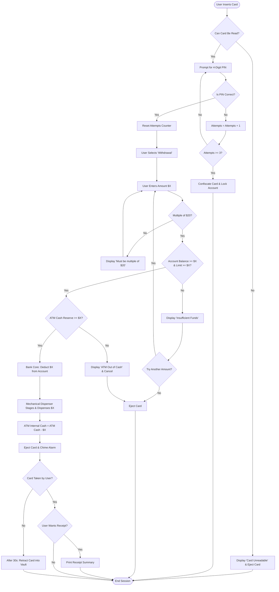

# Py-Section 1 Mission Project: The Digital Translator
**Mission:** mission-03  
**Squad:** Solo 434  
**Author:** Fredrick Ocheche (`ochechefredrick23`)

---

## Executive Summary

A computer does not possess intuition, instinct, common sense, or real-world perception. It is a deterministic machine governed by discrete mathematical and physical operations over digital representations. This project bridges human intent and computational reality through five progressive tiers of computer science thinking:

1. **Tier 1 — The Literal Assistant:** Translating ambiguous human directives into explicit, parameter-complete instructions.
2. **Tier 2 — Algorithm Thinking (The ATM):** Designing ordered, branch-aware algorithms with comprehensive failure handling.
3. **Tier 3 — Input → Processing → Output (The Calculator):** Structuring computations and implementing defensive exception handling.
4. **Tier 4 — Data Translator:** Mapping real-world entities into digital encodings, binary bits, and demonstrating data corruption modes.
5. **Tier 5 — Architecture Challenge (The Online Store):** Explaining the complete lifecycle from human input through application logic, processing, storage, and customer output.
6. **Capstone & Final Reflection:** Articulating the digital translation boundary across real-world systems.

---

# Tier 1 — Basic Understanding: The Literal Assistant

### The Core Problem: Human Ambiguity vs. Machine Determinism
When a human says **"Make me breakfast"**, the listener effortlessly uses contextual background:
- Time of day and kitchen environment.
- Known cultural or personal food preferences.
- Spatial awareness of where food, utensils, and appliances are stored.
- Intuitive culinary skills and common-sense safety (e.g., turning off the burner, discarding egg shells).

A completely literal assistant (a computer or autonomous machine) has **zero implicit context**. If given the string `"Make me breakfast"`, it cannot safely infer:
- *What* to cook.
- *Where* ingredients reside.
- *How much* to prepare.
- *What equipment* to operate.
- *When* the cooking process is complete.
- *Where* to deliver the finished meal.

---

### Step-by-Step Explicit Algorithm for Breakfast Preparation

```text
Objective: Prepare and serve 2 scrambled eggs with 1 slice of toasted whole wheat bread.

[Phase A: Preparation & Ingredient Retrieval]
1.  Navigate coordinates to the kitchen prep area.
2.  Locate the refrigerator door handle at (X: 120cm, Y: 85cm).
3.  Apply 15N pulling force until the refrigerator door opens to an angle >= 60 degrees.
4.  Scan top door shelf for egg carton labeled "Grade A Large Chicken Eggs".
5.  Open carton lid; verify >= 2 intact eggs are present.
6.  Grasp 2 eggs individually, remove them, and place them on the prep counter.
7.  Push the refrigerator door closed until the magnetic seal engages.
8.  Locate the bread box on the prep counter.
9.  Open bread box lid; retrieve 1 slice of whole wheat sandwich bread.
10. Place bread slice onto a clean prep plate; close bread box.
11. Retrieve 10-inch non-stick skillet and heat-resistant silicone spatula from cabinet #2.
12. Place skillet centered on the front-right stove burner.
13. Retrieve 1 clean ceramic mixing bowl, 1 fork, 1 dining plate, and 1 butter knife.

[Phase B: Toaster Operation]
14. Inspect 2-slice toaster on counter; verify AC power plug is firmly seated in wall receptacle.
15. Insert the 1 slice of bread vertically into the left toaster slot.
16. Rotate the browning dial to setting "3" (approx. 120 seconds duration).
17. Depress the carriage lever downwards until the mechanical catch locks.

[Phase C: Egg Preparation & Cooking]
18. Grasp egg #1; strike its equator against the ceramic rim of the mixing bowl with 4.5N force to fracture shell.
19. Position fractured egg over bowl, pry halves apart using thumb pads, and allow albumen and yolk to fall into bowl.
20. Deposit empty shell halves into organic waste bin. Repeat steps 18-20 for egg #2.
21. Take fork and whisk egg contents rapidly in circular motion for 30 seconds until yolk and white form a homogeneous yellow liquid.
22. Rotate front-right stove burner dial clockwise to "Medium" (setting 5).
23. Dispense 1 teaspoon (5ml) cooking oil into skillet center; wait 45 seconds for thermal dispersion.
24. Pour whisked egg mixture into skillet center.
25. Using spatula, sweep eggs gently from perimeter toward center every 5 seconds.
26. Continue sweep cycles until no free liquid egg flows across pan surface and coagulated soft curds are formed (90-120 seconds).
27. Immediately rotate front-right burner dial counter-clockwise to "OFF" (setting 0).

[Phase D: Plating, Delivery & Verification]
28. Upon toaster carriage release (lever pops up), retrieve toasted bread.
29. Place toast onto the left quadrant of the dining plate.
30. Using spatula, lift scrambled eggs from skillet and place onto right quadrant of dining plate.
31. Carry dining plate and fork to Dining Room Table.
32. Rest plate at Place Setting #1, placing fork 5cm to the left of the plate.
33. Safety Verification:
    - Verify front-right stove burner is OFF (0 Watts).
    - Verify toaster heating coils are unpowered.
    - Verify plate is resting securely on table.
34. Terminate process and emit status signal: "Breakfast is served."
```

---

### Reasoning Challenge: Analyzing Unconscious Assumptions

| Question | Hidden Human Assumption | Explicit Machine Requirement |
| :--- | :--- | :--- |
| **What food should be prepared?** | "Breakfast" implies standard morning foods known to the user. | Explicit recipe name: "2 scrambled eggs, 1 slice toasted bread". |
| **Where is the food?** | Ingredients are in their usual household spots. | Exact storage locations: top door shelf of fridge, bread box on counter. |
| **How much food is needed?** | "A normal portion for one person." | Quantitative counts: 2 eggs, 1 slice bread, 1 tsp oil. |
| **What equipment to use?** | Pick the right pan and spatula without scratching Teflon. | Specific tools: 10-inch non-stick skillet, silicone spatula, 2-slice toaster. |
| **What happens first / next?** | Toast and eggs should finish at roughly the same time. | Orchestrated parallel workflow: start toast before egg cooking begins. |
| **How should food be prepared?** | Don't eat raw eggs; don't burn the toast. | Specific heat setting (5), stirring interval (every 5s), visual doneness check. |
| **Where is it placed?** | Put it on the table where the person sits. | Specific target: Dining Room Table, Place Setting #1. |
| **How do we know it's finished?** | When food is ready and burners are off. | Deterministic post-condition assertion: heat sources OFF, plate delivered. |

**Key Takeaway:** Computers cannot fill in gaps. Missing information in human speech is harmless because humans possess shared common sense. Missing information in a computer program is a fatal bug or undefined behavior.

---

# Tier 2 — Field Exercise: Algorithm Thinking (The ATM)

### Problem vs. Algorithm vs. Program

- **The Problem (The Goal):** *"Withdraw money from an ATM."* (Describes *what* is desired, not *how*).
- **The Algorithm (The Solution Procedure):** A systematic, finite sequence of logical steps, conditionals, and error branches that solves the problem regardless of programming language.
- **The Program (The Concrete Implementation):** Executable code written in a specific language (e.g., Python, C++, Java) running on ATM hardware interacting with physical motors, sensors, and database APIs.

---

### Comprehensive ATM Withdrawal Algorithm



---

### Failure Mode Analysis

| Failure Condition | Risk / Danger | System Action & Safeguard |
| :--- | :--- | :--- |
| **Card cannot be read** | Corrupted chip or demagnetized stripe could hang hardware. | Detect hardware read failure within 3 seconds; cleanly disengage reader motors; eject card with explanatory prompt. |
| **Incorrect PIN entered** | Unauthorized person attempting brute-force PIN guessing. | Increment internal session counter; display remaining attempts; permanently confiscate card upon 3rd failed attempt and notify core fraud engine. |
| **Requested amount > balance** | Overdraft, negative balance, or unauthorized credit. | Query central bank core balance; if `amount > available_balance`, reject transaction immediately without touching ledger; offer retry. |
| **ATM has insufficient cash** | Machine debits user account but cannot physically dispense paper bills. | Perform pre-transaction hopper currency check. If `amount > atm_vault_cash`, display error *before* sending debit request to bank. |
| **Network drops mid-transaction** | Customer money deducted but cash not dispensed (or vice versa). | Implement **ACID Atomic Transactions with 2-Phase Commit**. If cash shutter sensor does not confirm delivery, trigger automatic rollback reversal transaction. |

---

# Tier 3 — Practical Exercise: Input → Processing → Output

### The Fundamental Computing Model

Every computer program operates on the **IPO model**:
```
    ┌──────────────┐       ┌─────────────────┐       ┌───────────────┐
    │    INPUT     │ ───►  │   PROCESSING    │ ───►  │    OUTPUT     │
    │  Raw Data    │       │ Transformation  │       │ Useful Result │
    └──────────────┘       └─────────────────┘       └───────────────┘
```

---

### Calculator Logic for `number_1 = 20`, `number_2 = 5`

#### 1. Addition
- **Input:** `number_1 = 20`, `number_2 = 5`
- **Processing:** Arithmetic sum (`20 + 5`)
- **Output:** `25`

#### 2. Subtraction
- **Input:** `number_1 = 20`, `number_2 = 5`
- **Processing:** Arithmetic difference (`20 - 5`)
- **Output:** `15`

#### 3. Multiplication
- **Input:** `number_1 = 20`, `number_2 = 5`
- **Processing:** Arithmetic product (`20 × 5`)
- **Output:** `100`

#### 4. Division
- **Input:** Dividend `number_1 = 20`, Divisor `number_2 = 5`
- **Processing:** Arithmetic quotient (`20 ÷ 5`)
- **Output:** `4.0`

---

### Reasoning Challenge: The Division by Zero Dilemma (`20 ÷ 0`)

#### What happens physically in computer hardware?
Division in a CPU ALU (Arithmetic Logic Unit) is performed through repeated subtraction or shift-and-subtract algorithms. If the divisor is `0`, the subtraction loop never terminates because subtracting zero from 20 leaves 20 indefinitely.
- In low-level assembly / machine code, attempting an integer divide by zero triggers a CPU hardware interrupt: **Trap: Division by zero** (`SIGFPE`).
- In an unmanaged or naive program, this immediately crashes the application with a core dump.

#### What should a well-designed program do?
A resilient program practices **defensive validation**:
1. **Pre-condition Validation:** Check the divisor *before* executing the division instruction.
2. **Graceful Branching:** If divisor is `0`, prevent the calculation, log the condition, and return a clean error object or user notification.
3. **Fail-Safe Integrity:** The program maintains uptime and remains ready for the next valid calculation.

```python
def divide_defensive(dividend: float, divisor: float):
    # Defensive Input Validation
    if divisor == 0:
        return {
            "status": "ERROR",
            "message": "Division by zero is mathematically undefined. Please supply a non-zero divisor."
        }
    return {
        "status": "SUCCESS",
        "result": dividend / divisor
    }
```

---

# Tier 4 — Conceptual Challenge: Data Translator

### Customer Data Representation

A computer cannot directly store the abstract concepts of human identity, age, or financial balance. It stores structured digital encodings.

| Information | Real-World Meaning | Computer Data Type | Digital / Binary Encoding Format |
| :--- | :--- | :--- | :--- |
| **Victor** | Human First Name | `String` (Character sequence) | **UTF-8 Bytes:** `0x56 0x69 0x63 0x74 0x6F 0x72`<br>**Binary:** `01010110 01101001 01100011 01110100 01101111 01110010` |
| **30** | Chronological Age | `Unsigned Integer` (8/32-bit) | **8-bit Binary:** `00011110` (Base 2 representation of 30) |
| **150000.50** | Bank Balance | `Scaled Integer` or `Decimal` | **In Cents (15000050):** `00000000 11100100 11100001 11110010`<br>*(Avoids IEEE 754 binary floating-point drift)* |
| **Yes** | Account Active State | `Boolean` (True/False flag) | **Single Bit:** `1` (Stored in memory as 1 byte: `00000001`) |

---

### The Abstraction Pipeline

```
REAL WORLD ENTITY
  │  Victor, 30 years old, holding $150,000.50 in active bank account
  ▼
DATA REPRESENTATION (Language Level)
  │  String: "Victor" | Int: 30 | FixedPoint: 150000.50 | Bool: True
  ▼
DIGITAL ENCODING (System Level)
  │  UTF-8 charset | Two's complement integer | IEEE 754 / BCD | 1-byte flag
  ▼
BINARY DATA (Hardware Level)
  │  01010110 01101001 ... 00011110 ... 00000001
  ▼
PHYSICAL STATE (Silicon / Storage Level)
     Capacitor charges in DRAM, floating-gate transistor states in NVMe SSD
```

---

### Reasoning Challenge: The Catastrophe of Data Misinterpretation

Raw binary bits have no intrinsic meaning. A sequence of 64 bits could be a floating-point number, a signed integer, an image pixel, or machine code instructions.

If the stored balance `150000.50` is misinterpreted:

1. **Type Confusion (Reading Float bits as Integer):**
   - In 64-bit IEEE 754, `150000.50` is stored in hexadecimal as `0x41024F8400000000`.
   - If an application component reads those 8 bytes as a signed 64-bit integer, the account balance becomes **`4,684,393,990,773,014,528`**!
   - *Impact:* The customer appears to have trillions of dollars, potentially allowing catastrophic fraudulent withdrawals.

2. **Scaling Mismatch (Cents vs. Dollars):**
   - Financial ledgers store $150,000.50 as integer cents: `15000050`.
   - If an updated microservice treats the integer as whole dollars, Victor's balance becomes **$15,000,050.00** (100x inflation).
   - If a payment gateway receives `150000.50` and divides by 100 assuming it was in cents, Victor's balance drops to **$1,500.00** (100x deflation).

3. **Floating-Point Drift:**
   - Using standard binary floating-point (`float32`/`float64`) for money causes rounding errors (e.g., `0.1 + 0.2 = 0.30000000000000004`).
   - Over millions of transactions, financial balance audits fail to balance.

---

# Tier 5 — Architecture Challenge: Explain the Whole System (The Online Store)

### 1. The Completed Architectural Chain

```text
Customer
   ↓
[1] User Interface / Input Gateway
   ↓
[2] Application / Business Logic Layer
   ↓
[3] Processing & Calculation Engine
   ↓
[4] Persistent Storage / Database
   ↓
[5] Output & Fulfillment Pipeline
   ↓
Result (Customer Receipt & Warehouse Picking Order)
```

---

### 2. Comprehensive System Breakdown

#### A. What is the computer doing?
At the hardware level, servers and client machines are executing millions of clock cycles per second. The client CPU captures keyboard/mouse events, encrypts data into TLS packets, and transmits them over network interfaces. The server CPU receives TCP segments, decrypts payloads in RAM, schedules process threads, instructs memory controllers to load database pages, and writes persistent blocks to NVMe flash storage.

#### B. What is the program doing?
The software serves as the logic orchestrator. It sits between raw network requests and database storage:
- It parses incoming JSON/HTTP payloads.
- It verifies authentication tokens and session validity.
- It applies business rules (pricing models, tax rates, inventory constraints).
- It calls third-party APIs (payment gateway authorization).
- It constructs persistent database transactions and crafts response views.

#### C. What data is involved?
- **Transient Data (In-Flight):** Session tokens, HTTP request headers, credit card CVV (processed in memory, never persisted), real-time timestamps.
- **Reference Data:** Product SKU catalog, stock inventories, unit prices, geographical tax tables.
- **Transactional Data:** Order records, line item quantities, applied discounts, customer delivery address, payment settlement tokens.

#### D. What instructions are being executed?
```text
1. VALIDATE customer_input(sku, quantity, address, payment_token)
2. LOCK inventory_record FOR sku = "SKU-HEADPHONES"
3. IF stock_quantity < quantity THEN RAISE OutOfStockException
4. COMPUTE subtotal = unit_price * quantity
5. COMPUTE tax = subtotal * tax_rate
6. COMPUTE order_total = subtotal + tax
7. CALL PaymentGateway.authorize(payment_token, order_total)
8. UPDATE inventory SET stock_quantity = stock_quantity - quantity
9. INSERT INTO orders_table (order_id, customer_id, total, status, timestamp)
10. COMMIT TRANSACTION
11. RENDER confirmation_email(order_id, order_total)
```

#### E. What is the output?
1. **To the Customer:** A rendered web confirmation screen and email receipt showing:
   `"Order #ORD-D8CDD164 confirmed. Total: $105,000.00. Estimated delivery: 2-3 business days."`
2. **To the Fulfillment Center:** An automated warehouse dispatch ticket instructing automated sorters to pick 2 units of SKU-HEADPHONES.
3. **To the Accounting System:** A ledger entry recording accounts receivable and sales tax payable.

#### F. What information must be stored for the system to remember the order?
To guarantee auditability and survive system restarts, the database persists:
- `order_id` (Primary Key, unique UUID).
- `customer_id` (Foreign key to customer table).
- `sku` and `quantity`.
- `unit_price_at_purchase` *(Critical: must freeze price at time of purchase so future price changes do not alter historical records)*.
- `subtotal`, `tax_paid`, and `total_charged`.
- `shipping_address_snapshot`.
- `payment_gateway_reference_id`.
- `order_status` (`PAID`, `FULFILLED`, `SHIPPED`, `DELIVERED`).
- `created_at` timestamp.

---

# Capstone Mental Model

```
REAL-WORLD PROBLEM
       ↓
     DATA
       ↓
    PROGRAM
       ↓
  INSTRUCTIONS
       ↓
   PROCESSING
       ↓
  STORED DATA
       ↓
    OUTPUT
```

A computer does not possess autonomous problem-solving awareness. To bridge reality and machine computation, a software engineer must act as a **Digital Translator**:
1. Identify the real-world problem.
2. Structure the entities as well-defined data representations.
3. Design an algorithm accounting for success and failure modes.
4. Express that algorithm as program instructions.
5. Direct hardware processing of the data.
6. Persist critical state reliably.
7. Return a meaningful, actionable result to the human user.

---

# Final Reflection

> *"A computer does not understand the real world directly. It works with representations of information and follows instructions for processing those representations."*

### Synthesized Insight

Human beings inhabit an analog world of meaning, emotion, physical sensations, and implicit context. When a person feels hungry, they understand the physical sensation and intuitively know that a refrigerator contains food.

A computer has no access to physical reality. It cannot smell smoke, taste an egg, or feel the tactile weight of paper money. A computer operates solely inside an artificial symbolic domain. It manipulates electrical voltage states that human engineers have structured to represent numbers, letters, colors, or states.

Therefore:
- **Breakfast is not food to a computer:** It is a collection of timer floats, temperature integer thresholds, and robotic motor coordinate vectors.
- **Money is not wealth to a computer:** It is an unsigned 64-bit integer representing cents in a database row.
- **A customer is not a human being to a computer:** It is a UTF-8 character string and an indexed foreign key.

Computers achieve extraordinary feats not because they understand human reality, but because human programmers have meticulously constructed **isomorphic mappings** between real-world situations and digital representations, paired with **sound instructions** that transform those representations reliably. When those representations or instructions contain errors, the machine does not notice; it continues executing faithfully, revealing that the "intelligence" of the machine is entirely reflective of the precision of its human translator.
